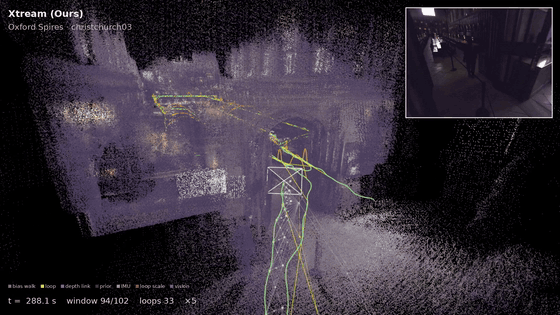
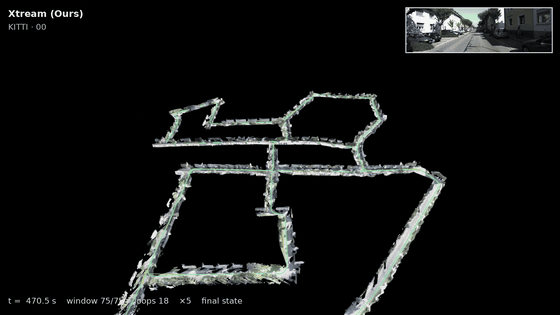

# Xtream: An Explicit Metric State for Large-Scale Streaming Reconstruction

**[Paper](https://arxiv.org/abs/2611.31757)** · **[Project Page](https://ernestolozano.github.io/xtream/)**

<p align="center">
  
  
</p>
<p align="center"><sub>5× speed. Left: mono-inertial on Oxford Spires christchurch03, loops closing as the camera
returns to the dining hall. Right: monocular on KITTI 00, the final map.</sub></p>

Xtream reconstructs long sequences in a stream, with one camera (**monocular**) or one camera plus an IMU
(**mono-inertial**). A single 3D foundation model, [Depth Anything 3](https://github.com/ByteDance-Seed/Depth-Anything-3),
predicts every view; an explicit graph joins its predictions into one consistent, metric trajectory and map.

- **Front end** (`xtream/frontend`): one DA3 pass per window of 64 frames; the windows' depth on their shared
  frame links their units; covisibility edges and loop closures as further DA3 passes, retrieved with SALAD.
- **Back end** (`xtream/backend`): the explicit graph — poses, the metre (unit) of every window, and, with the IMU,
  velocities, biases and preintegrated IMU factors — solved incrementally as the outputs arrive.
- **Metric scale**: from the IMU in mono-inertial mode (VI3's GT-free init, `xtream/init`, then the IMU factors), from a
  metric depth model on each window's keyframes in monocular mode (uncalibrated: DA3 predicts the intrinsics).
- **Reconstruction** (`xtream/reconstruction`): `base` reuses the front end's own window passes (no extra network pass);
  `cond` adds DA3 passes conditioned on the back end's live poses, one scale per pass.

## Install

Tested with Python 3.10, CUDA 12.8 and torch 2.11 on one 32 GB GPU.

```bash
conda create -y -n xtream python=3.10 && conda activate xtream

# PyTorch for your CUDA version first
pip install torch==2.11.0 torchvision==0.26.0 --index-url https://download.pytorch.org/whl/cu128

pip install -r requirements.txt
pip install -e . --no-deps

python scripts/download_checkpoints.py    # CLoSeR's loop detector, SALAD (ckpt/), the two DA3 models (HF cache)
```

Depth Anything 3 and GeoCalib are vendored in `third_party/` (see each `VENDORED.md`). CLoSeR's loop detector is
not redistributed: `download_checkpoints.py` fetches the files Xtream uses from its repository, at a fixed commit,
into `third_party/CLoSeR/`. Nothing else needs installing. GeoCalib's weights download on the first mono-inertial run.

## Data

`scripts/download_data.py` fetches each dataset from its official source, `scripts/prepare_data.py` writes the
images Xtream reads. Everything goes under `data/` (or `$XTREAM_DATA`), in the layout of `configs/datasets.yaml`;
`--sequences` restricts both to some sequences.

| dataset | modes | download | prepare | size |
|---|---|---|---|---|
| EuRoC MAV (11 seq.) | both | `python scripts/download_data.py euroc` | `python scripts/prepare_data.py euroc` | ~1.5 GB / seq. |
| KITTI odometry 00–10 | monocular | `python scripts/download_data.py kitti` | — | ~1–6 GB / seq. |
| Oxford Spires (11 seq.) | both | `python scripts/download_data.py oxford_spires` | `python scripts/prepare_data.py oxford_spires` | ~3–8 GB / seq. |
| ScaRF r01–r05 | both | `python scripts/download_data.py scarf` | `python scripts/prepare_data.py scarf` | ~2 GB / seq. |
| VBR (7 training seq.) | both | `python scripts/download_data.py vbr` | — | ~11–24 GB / seq. |

KITTI is read from the official colour zip by range requests, so only the requested sequences are downloaded.
VBR's images and ground truth come from the LoGeR authors' processed release. Its IMU only exists in the official
ROS bags (43–177 GB per sequence), which `download_data.py vbr` downloads one at a time (~10 GB each), reads, and
deletes. If the official server is down, it takes the IMU and calibration instead from a ~40 MB archive of the
same files extracted from those bags
([ernestolozano/vbr-imu-calib](https://huggingface.co/datasets/ernestolozano/vbr-imu-calib), CC BY-SA 4.0);
`--vbr_imu archive` uses it directly, without the bags (`--vbr_imu bags` forces them).
Data already on disk elsewhere can be used as is: copy `configs/datasets.yaml`'s keys you need into
`configs/datasets.local.yaml` with absolute paths.
`xtream/data/README.md` lists what each loader reads.

## Run

```bash
python scripts/run.py --mode mono-inertial --dataset euroc --seq V1_01_easy
python scripts/run.py --mode mono --dataset kitti --seq 00,05
python scripts/run.py --mode mono-inertial --dataset oxford_spires --seq obs02 --map cond --ply
```

The configurations are `configs/mono_inertial.yaml` and `configs/mono.yaml` (`--config` takes your own file).
Each run writes `results/<dataset>/<mode>/<sequence>/`: `est.txt` (camera poses, TUM), `run.json` (configuration,
timings), `backend_inputs.pkl` (the back end's inputs) and `map_inputs/` (for the map export). `--map` exports the
map after each run (see Reconstruction).

## Evaluate

```bash
python scripts/evaluate.py --mode mono-inertial --dataset euroc --seq all --plot
```

ATE after SE(3) and Sim(3) alignment, RPE over 1 m, scale and FPS per sequence, at the camera, against each
dataset's ground truth (`xtream/eval/trajectory.py`). `--plot` also draws each run's top view against the ground
truth, after the ATE's alignment (SE(3) mono-inertial, Sim(3) monocular): `trajectory.png` in the run.

## Reconstruction

`--map base` reuses the depth of the front end's own window passes (no extra network pass); `--map cond` adds DA3
passes conditioned on the back end's live poses, one scale per pass (more accurate, for 10–20 % more time; ~50 % on
KITTI). Either writes one coloured camera-frame cloud per map frame (5 Hz), `<sec>_<nsec>.pcd`, in `map_base/` or
`map_cond/` of the run; place it in the world with the frame's pose in `est.txt`. `--ply` also writes the whole map
as one world-frame, coloured cloud, `map_<base|cond>.ply` (voxel `--voxel`, 2 cm), to open in MeshLab, CloudCompare
or Open3D. The export keeps the confident points within 5 m of their camera, where DA3's depth is accurate (the
paper's setting); `--range_m` sets another distance, and `--raw` keeps every confident point, whatever its distance.

`scripts/export_map.py` takes the same options to export, or re-export, the map of finished runs:

```bash
python scripts/export_map.py --mode mono --dataset kitti --seq 04 --map base --ply --voxel 0.1
```

## Run it on your own data

Monocular Xtream is **uncalibrated**: the 3DFM predicts the intrinsics, so any video runs as it is, with no calibration
beforehand. The `custom` dataset reads a folder of images:

```bash
mkdir -p data/custom/my_video/images
ffmpeg -i my_video.mp4 data/custom/my_video/images/%06d.png
python scripts/run.py --mode mono --dataset custom --seq my_video --map cond --ply
```

Images are spaced at `fps` (30, in `configs/datasets.yaml`) unless a `times.txt` gives one stamp per image [s]; an
optional `gt.txt` (TUM camera poses) enables `evaluate.py`. A ROS 2 bag becomes such a folder with `rosbags`
(installed): its camera topic's images in `images/`, their header stamps in `times.txt`. For other data, e.g. with an
IMU, `xtream/data/custom.py` is a short example of a loader: write one returning a `Sequence` (`xtream/data/base.py`),
add it to `DATASETS` in `xtream/data/__init__.py` and to `configs/datasets.yaml`.

## Repository

```
configs/           mono.yaml, mono_inertial.yaml, datasets.yaml
scripts/           download_data.py, download_checkpoints.py, prepare_data.py, run.py, export_map.py, evaluate.py
xtream/
  pipeline.py      the streaming loop on one sequence
  frontend/        DA3 passes, covisibility retrieval, loop detection, the monocular metric prior
  backend/         the explicit graph and its feed
  init/            VI3's GT-free visual-inertial init (gravity, gyro bias, metric scale)
  reconstruction/  base and conditioned map export, the fused PLY
  data/            dataset loaders (`custom`: your own images), undistortion, VBR frame stamps
  eval/            trajectory scores, top-view plot
third_party/       Depth-Anything-3, GeoCalib (vendored); CLoSeR (loop detection, fetched)
assets/            README animations (Oxford Spires christchurch03, KITTI 00)
```

## Citation

```bibtex
@misc{lozano2026xtreamexplicitmetricstate,
  title         = {Xtream: An Explicit Metric State for Large-Scale Streaming Reconstruction},
  author        = {Ernesto Lozano and Alberto Jaenal and Javier Civera},
  year          = {2026},
  eprint        = {2611.31757},
  archivePrefix = {arXiv},
  primaryClass  = {cs.CV},
  url           = {https://arxiv.org/abs/2611.31757},
}
```

## License and acknowledgements

Xtream is released under the [Apache License 2.0](LICENSE), copyright 2026 Universidad de Zaragoza. The vendored code
in `third_party/` keeps its own license:
[Depth Anything 3](https://github.com/ByteDance-Seed/Depth-Anything-3) (Apache-2.0) and
[GeoCalib](https://github.com/cvg/GeoCalib) (Apache-2.0). Loop detection runs
[CLoSeR](https://github.com/MoyangLi00/CLoSeR)'s detector with [SALAD](https://github.com/serizba/salad) (GPL-3.0)
on [DINOv2](https://github.com/facebookresearch/dinov2) (Apache-2.0); neither that code nor SALAD's checkpoint is
part of this repository, both are downloaded from their authors' releases and keep their terms.
The IMU init is [VI3](https://github.com/ErnestoLozano/vi3)'s.
Data preparation follows [MASt3R-Fusion](https://github.com/GREAT-WHU/MASt3R-Fusion) (EuRoC),
the [Oxford Spires](https://github.com/ori-drs/oxford_spires_dataset) tools and
[FoundationVIO](https://github.com/ori-drs/FoundationVIO) (ScaRF). The datasets keep their own licenses and terms of use.
